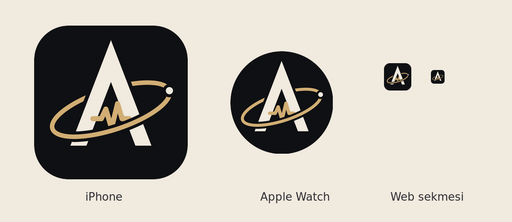

# AntiGravity brand mark



`antigravity-logo.svg` is the single source for every icon. The mark is an upward "A" (lift, against gravity),
a tilted orbit ring with a small satellite (spaceflight, after the NASA / ESA / TUA tradition of orbit swooshes),
and a pulse line as the crossbar (health monitoring).

Colors follow the web theme in `web/src/cosmos-shell.css`: anthracite `#0f1013`, marble `#f0eadf`, brass `#d2ae74`.

## Regenerate the icons

```bash
node docs/brand/build-icons.mjs   # from the repo root; needs Playwright (Chromium) and ImageMagick
```

| Output | Use |
| --- | --- |
| `web/public/favicon.svg`, `favicon-32.png` | Browser tab |
| `web/public/apple-touch-icon.png` (180) | iOS home screen bookmark |
| `web/public/icon-192.png`, `icon-512.png` | PWA / large icon |
| `Antigravity_iOS/.../AppIcon.appiconset/AppIcon-1024.png` | iPhone app icon (opaque, square; iOS rounds the corners) |
| `Antigravity_watchOS/.../AppIcon.appiconset/AppIcon-1024.png` | Watch app icon (opaque; watchOS crops it to a circle) |
