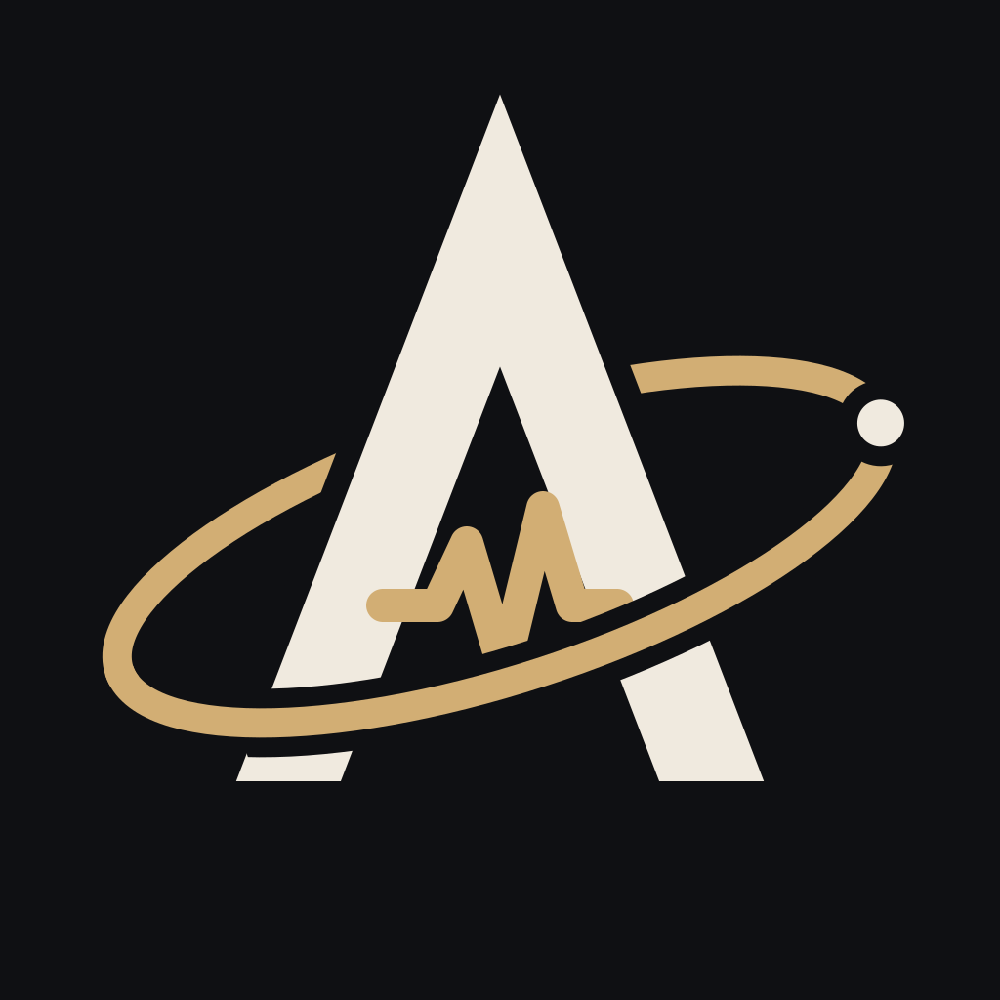

# AntiGravity — Web Dashboard (One-Page Pitch Report)

**Owner:** Ahmet Özkan (`@Ahmetzkn`) · **Area:** Web Dashboard (Main Demo Surface) · **Live URL:** https://antigravity-teal-eight.vercel.app/

## 1. What I Built

- **3B Vücut Haritası ve Sağlık Kokpiti:** Her astronotun sağlık durumunu tek ekranda toplayan, tıklanabilir 3 boyutlu vücut haritası ve renk kodlu gösterge kartları.
- **Kesintisiz Canlı Veri Akışı:** Ekip verileri sunucudan anlık güncellenir; bağlantı kesilse bile ekran boş kalmadan yerleşik yedek veriyle çalışmayı sürdürür.
- **Sade Görev ve Üs Yönetimi:** Komutanların ekibe görev ve mesaj iletebildiği sadeleştirilmiş Ana Üs ekranı ile sabit Alçak Dünya Yörüngesi (ISS) görev bilgisi.
- **Okunabilir 7 Günlük Eğilim ve Sabit Rehberlik:** Her günü tek temiz noktada özetleyen 7 günlük grafik, her zaman açık rehberlik paneli ve sol sütunda yapay zekâ sohbeti.
- **Sahne Dostu Senaryo Kontrolü:** Yalnızca bir senaryo çalışırken görünen durdurma tuşu ile temiz demo akışı.

## 2. Selling Points for the Jury

- **Tek bakışta müdahale:** Renk kodlu kartlar ve 3B vücut haritası, hangi astronotun hangi bölgesinde sorun başladığını saniyeler içinde gösterir.
- **Anlık değerden öte erken uyarı:** 7 günlük eğilim grafiği, tek ölçümde gizlenen yavaş bozulmaları (uyku azalması, tansiyon artışı) erkenden yakalar.
- **Kesintiye dayanıklı çalışma:** İnternet veya sunucu bağlantısı kopsa bile kokpit yerleşik yedek verilerle kesintisiz izlemeyi sürdürür.
- **Kurulumsuz canlı erişim:** Jürinin ve ekibin tarayıcıdan anında açabildiği çalışan sistem: https://antigravity-teal-eight.vercel.app/

## 3. Demo Moment (On Stage)

- **Açılış (25 sn):** Tüm 3 astronotun **yeşil** başladığı ana kokpit açılır; 3B vücut haritasında bölge seçimi ve 7 günlük eğilim grafiği gösterilir.
- **Canlı Kriz Anı (15 sn):** Senaryo başlatılınca seçili kart ve ilgili vücut bölgesi **canlı olarak kırmızıya döner**; yanındaki açık rehberlik paneli ve yapay zekâ sohbeti anında çözüm sunar.

## 4. Presenter & Timing

- **Sunucu:** Ahmet Özkan (`@Ahmetzkn`) · **Önerilen Süre:** 35–40 saniye (`0:25 – 1:05` arası)
- **Konuşma Planı (Türkçe):** İlk 25 saniyede yeşil başlangıç ekranı, 3B vücut haritası ve 7 günlük eğilim tanıtılır; ardından 15 saniyede canlı kriz geçişi gösterilerek söz mobil/saat ve AI sunumuna devredilir.

## 5. Facts & Numbers

- **9 sağlık göstergesi** · **3 astronot profili** · **7 günlük eğilim penceresi**
- Canlı web kokpiti **Vercel** üzerinde yayında ve **Render** bulut sunucusuyla anlık bağlantılı.

## 6. Challenges Solved

- **Canlı akışın korunması:** Ekip birleştirmeleri sırasında duran anlık telemetri akışı tespit edilip veri kaybı olmadan geri kazandırıldı.
- **Grafik okunabilirliği:** Aynı gün içinde sık gelen canlı ölçümlerin gün etiketlerini taşırması ve sağ uçta dikey sıçrama yaratması günlük özetleme ile düzeltildi.

## 7. Next Steps

- Tüm mürettebatı tek tabloda kıyaslayan çoklu karşılaştırma görünümü ve aylar süren derin uzay görevleri için uzun dönem sağlık özetleri.

---

*Demo software, not a medical device.*
