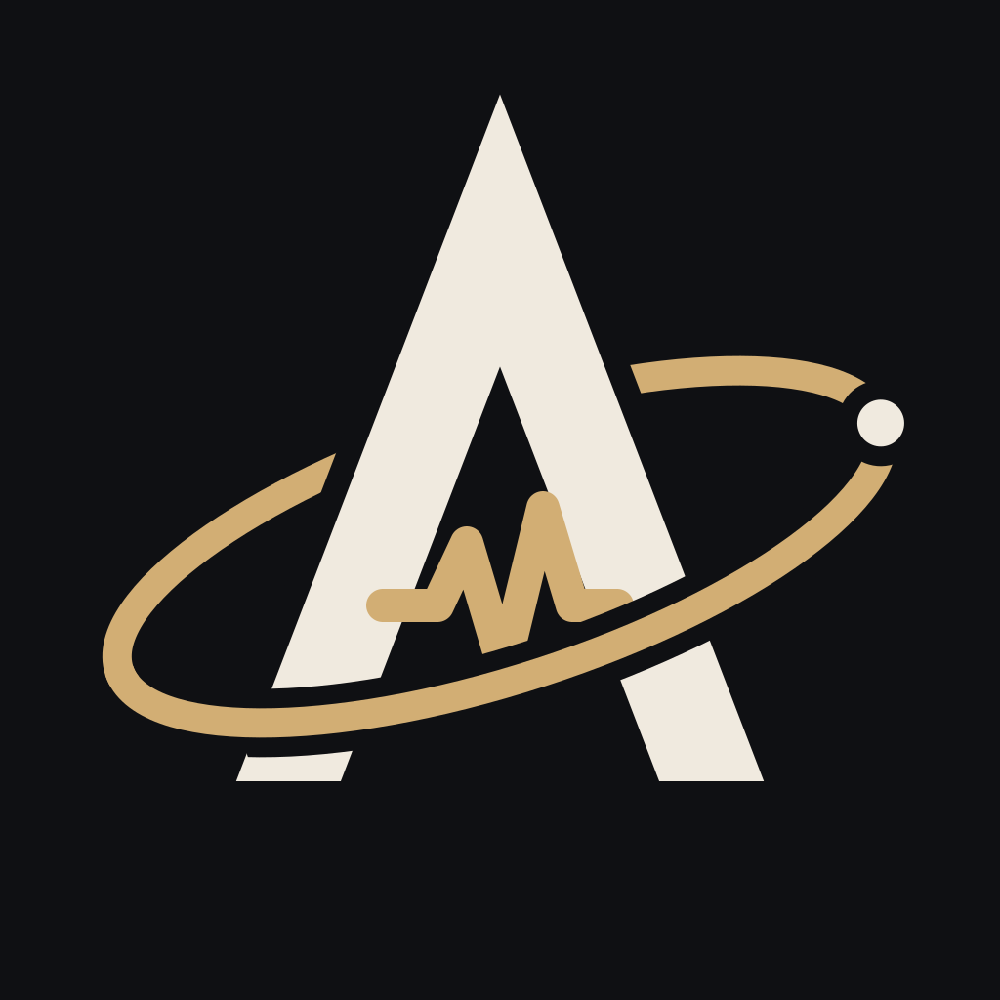

# AntiGravityCHS — iPhone & Apple Watch Apps (One-Page Pitch Report)

**Owner:** Emirhan Gökçe (`@Skylowerr`) · **Area:** iPhone 16 Pro & Apple Watch (`AntiGravityCHS`) · **Language:** Turkish UI

## 1. What I Built

- **Tek Projede iPhone ve Apple Watch (`AntiGravityCHS`):** iPhone 16 Pro ve Apple Watch uygulamalarını ortak sağlık kuralları ve tek veri sözleşmesiyle sıfırdan geliştirdim.
- **Canlı Üs ↔ Telefon ↔ Saat Senkronu:** Komuta merkezinden (web) başlatılan senaryolar, sağlık değişimleri ve görevler saniyeler içinde iPhone’a ve bileğe iletilir.
- **Vücut Haritalı iPhone Kokpiti:** Etkileşimli vücut haritası, uyku/tansiyon/radyasyon halkaları, yapay zekâ öneri kartı ve sade Türkçe rehberlik ekranı ile astronot durumunu tek bakışta anlar.
- **Davranışsal Ruh Hâli ve Görev Döngüsü:** Uyku, belirti ve günlük notlarından ruh hâlini otomatik hesaplar; komuta merkezinden gelen görevleri tamamlayınca merkezdeki uyarıyı otomatik kapatır.
- **Saat İçin Kademeli Titreşim ve Arka Plan Bildirimi:** Saat açık olmasa bile yeni görev ve tehlike bildirimlerini bileğe düşürür; hafif sapmada yumuşak, kritik tehlikede yoğun titreşimle yalnızca saatten uyarır.

## 2. Selling Points for the Jury

- **Bilekte akıllı ve kademeli uyarı:** Astronot ekrana bakmasa bile tehlikenin ciddiyetini saatindeki titreşim şiddetinden hisseder; telefon gereksiz yere titremez.
- **Üç cihaz, tek ortak sağlık dili:** Web komuta merkezi, iPhone ve Apple Watch aynı canlı veri akışından beslendiği için ekipler arası bilgi çakışması yaşanmaz.
- **İzolasyona karşı davranışsal sağlık takibi:** Günlük notları, uyku düzeni ve belirtileri birleştirerek derin uzay görevlerindeki psikolojik yıpranmayı erkenden yakalar.
- **Gerçek Apple cihazlarda çalışan yerli deneyim:** Hazır video yerine doğrudan iPhone 16 Pro ve Apple Watch üzerinde çalışan gerçek zamanlı uygulama olarak sunulur.

## 3. Demo Moment (On Stage)

- **Canlı Kriz ve Görev Anı (~25 sn):** Web’den bir kabin senaryosu veya Houston görevi tetiklendiği anda iPhone (`AntiGravityCHS`) ekranına canlı uyarı bildirimi düşer, bilekteki Apple Watch kademeli titreşimle alarm verir; astronot vücut haritasından öneriyi görüp görevi tamamladığında uyarı komuta merkezinde kapanır.

## 4. Presenter & Timing

- **Sunucu:** Emirhan Gökçe (`@Skylowerr`) · **Önerilen Süre:** 35–40 saniye (canlı demo bloğunda web kriz tetiklemesinin hemen ardından, `~3:45 – 4:25`).
- **Konuşma Planı (Türkçe):** İlk 10 saniyede iPhone vücut haritası ve günlük/ruh hâli ekranı tanıtılır; sonraki 25 saniyede web’den gelen kriz ve görevin telefona bildirim + saate kademeli titreşim olarak yansıması gösterilip söz ana sunuma devredilir.

## 5. Facts & Numbers

- **34** Swift dosyası · **~8.100** satır kod (8.132 satır) · **2** gerçek Apple platformu (iPhone 16 Pro + Apple Watch).
- **9** sağlık göstergesi · tamamen **Türkçe** arayüz · **3** seviyeli net durum sistemi (Yeşil / Amber / Kırmızı).

## 6. Challenges Solved & Next Steps

- **Çözülen Zorluklar:** Canlı sunucu akışındaki boş satır ayrıştırma hatası giderilerek görevlerin anında gelmesi sağlandı; yapay zekâ ruh hâli ve öneri ekranları özet/detay görünümlerinde birleştirildi; saat kapalıyken bildirim iletimi ve iki kademeli titreşim kuruldu.
- **Sonraki Adımlar:** Apple Watch sağlık sensörlerinden doğrudan gerçek nabız ve oksijen verisi okuma; iletişim kesintilerinde ölçümleri cihazda saklayıp bağlantı gelince eşitleme.

---

*Demo software, not a medical device.*
