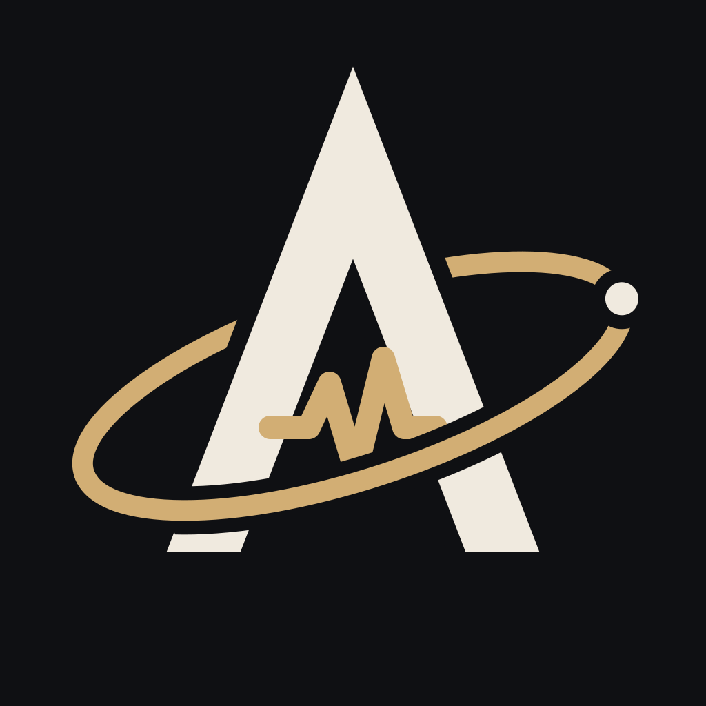

# ANTIGRAVITY — AI, Proactive Alerts, Chat & Voice (One-Page Pitch Report)

**Owner:** Göktuğ Ferdi Uylaş (`@GoktugFerdi`) · **Area:** AI module, proactive alerts, chat, voice alert · **Language:** Turkish UI

## 1. What I Built

- **Proaktif uyarı sistemi:** Astronot sormadan sistem ölçümleri izler, sorunu yakalar ve ne yapılacağını söyler. Uyarı web, iPhone ve Apple Watch'a aynı anda düşer; kilitli telefon için isteğe bağlı bir bildirim kanalı da vardır.
- **Yapay zekâ açıklaması:** Gemini, uyarının ne anlama geldiğini, uzayda neden önemli olduğunu, şimdi ne yapılacağını ve uçuş cerrahına ne zaman başvurulacağını sade Türkçeyle anlatır. İlaç öneren ya da bozuk cevaplar reddedilir.
- **Uyarıdan göreve:** Her uyarının çözüm adımları, etkilenen astronotun görev listesine anında düşer; uyarı bitince görevler de kalkar.
- **AI sohbet:** Astronot "Şu anki durumum nedir?" diye sorar, sistem güncel ölçümlere bakarak cevap verir. İlaç ve doz soruları güvenle yönlendirilir.
- **Kabin izleme ve senaryolar:** Oksijen, karbondioksit, basınç, sıcaklık, nem, gaz, radyasyon ve yaşam destek gücü izlenir. Hazır kriz senaryoları ve üç tarihî kaza tekrarı vardır.
- **Türkçe sesli uyarı:** Kritik uyarıda kısa bir cümle okunur; eller meşgulken bile duyulur. Ses ayarları panelinden kapatılabilir.
- **Web arayüzü:** Tarama çizgisi ve kimlik kartı, Senaryolar sekmesi ve mürettebat kokpiti.

## 2. Selling Points for the Jury

- **AI renk vermez:** Yeşil, sarı ve kırmızıyı sabit eşik kuralları belirler; AI yalnızca açıklar. Yanlış bir yapay zekâ cevabı durumu değiştiremez.
- **İnternet ya da AI yoksa da çalışır:** Gemini cevap vermezse hazır Türkçe kural tabanlı öneri gelir, uyarı gecikmez.
- **Proaktif:** Astronotun sorması gerekmez; sistem uyarır ve ilk adımı söyler. Dünya ile iletişim 20 dakika gecikse bile mürettebat önce harekete geçebilir.
- **Tek uyarı, tüm cihazlar aynı anda:** Aynı sorun için tekrar tekrar uyarı gelmez; kim gördü, kim onayladı izlenir.
- **Her uyarı bir iş listesine dönüşür:** Astronot "ne yapacağım?" diye düşünmez, adımlar görev olarak karşısındadır.

## 3. Demo Moment (On Stage)

- **Kabinde gaz sızıntısı (~25 sn):** Senaryolar sekmesinden gaz sızıntısı başlatılır; uyarı web, iPhone ve Apple Watch'ta aynı anda belirir, kısa sesli uyarı çalar, AI önerisi ve görev adımları görünür.
- **AI sohbet (~20 sn):** "Şu an durumum nedir, uçuş cerrahına ne zaman başvurmalıyım?" sorusuna güncel ölçümlere dayalı cevap gelir.

## 4. Presenter & Timing

- **Sunucu:** Göktuğ Ferdi Uylaş (`@GoktugFerdi`) · **Önerilen Süre:** 45 saniye (`1:05 – 1:50`, Ahmet'in canlı kriz geçişinden hemen sonra).
- **Konuşma Planı (Türkçe):** İlk 10 saniyede "AI renk vermez, sadece açıklar" ilkesi anlatılır; sonraki 15 saniyede gaz sızıntısı uyarısı üç cihazda gösterilir; son 20 saniyede AI sohbet sorusu sorulup söz sonraki konuşmacıya devredilir.

## 5. Facts & Numbers

- **47** otomatik test, hepsi geçiyor · **12** hazır kriz senaryosu · **3** tarihî kaza tekrarı (Apollo 13, Mir yangını, ISS EVA-23).
- **8** kabin ölçümü izlenir · uyarılar **5 dakika** boyunca tekrar edilmez · **52** hazır ses kaydı.
- Yapay zekâ modeli Gemini; anahtarı yalnızca sunucuda durur, uygulamalara hiç ulaşmaz.

## 6. Challenges Solved & Next Steps

- **Çözülen Zorluklar:** Canlı ortamda Gemini'nin yanıt vermediği veya geciktiği anlar için yedek model, tek yeniden deneme ve sabit süre sınırı kuruldu; Apollo 13 tekrarında çift çıkan tansiyon uyarısı tek uyarıya indirildi; uyarı yorgunluğuna karşı sessiz ses, istek üzerine öneri ve kaçırılan uyarıyı yakalama eklendi.
- **Sonraki Adımlar:** Gerçek uçuş cerrahı protokolleriyle doğrulanmış kural seti ve internetsiz çalışan cihaz üstü model.

---

*Demo software, not a medical device.*
