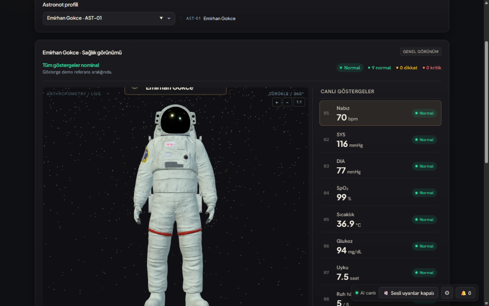

# ANTIGRAVITY — Web Visual Design & Astronaut Health Cards

**Owner:** Ömer Özcan · **Scope:** Web görsel dili, Apple Watch telemetri ve yapay zekâ öneri kartları · **Sunum Dili:** Türkçe

## 1. What I Built

- **Apple Watch Telemetri Kartı:** Astronotun saatten gelen adım, kalori, egzersiz, kabin basıncı, irtifa ve 3 eksenli G-kuvveti verilerini tek bakışta okunan bir özet kartında toplar.
- **Yapay Zekâ Bakım Önerisi Kartı:** Sağlık verilerinden üretilen kısa özeti, hemen uygulanabilecek adımları ve uçuş cerrahına ne zaman başvurulacağı bilgisini tek kartta sunar.
- **Ortak Astronot Veri Paketi Bağlantısı:** Astronot profillerini ve cihaz verilerini tek kaynaktan besleyerek tüm web kartlarının uyumlu çalışmasını sağlar.
- **Görsel Kimlik ve Sadeleştirme:** İç içe kutuları kaldıran, göz yormayan koyu titanyum–obsidyen zemin ile sıcak pirinç–mermer vurgulu durum etiketleri ve sade Türkçe metinler kurar.

## 2. Selling Points for the Jury

- **Daha az gürültü, daha hızlı karar:** Sadeleştirilmiş kart düzeni sayesinde astronot kritik veriyi ilk bakışta fark eder.
- **Saat verisi ve yapay zekâ önerisi aynı ekranda:** Bilekten gelen telemetri ile bakım adımları tek pencerede birleşir, ayrı uygulama gerektirmez.
- **Herkes için erişilebilir durum etiketleri:** Normal, Dikkat ve Kritik durumları yalnızca renge değil, hem renk hem metin ve ikona dayanır.
- **Görev stresini azaltan uzay arayüzü:** Düşük parlamalı koyu titanyum palet ve net tipografi uzun süreli görevlerde ekran okunabilirliğini korur.

## 3. Demo Moment (On Stage)

- **Sahne anı (~20 sn):** Web panelinde astronotun durum etiketleri (`Normal / Dikkat / Kritik`) gösterilir; ardından Apple Watch telemetri kartı ile Yapay Zekâ Önerisi kartındaki *Özet → Önerilen Adımlar → Uçuş Cerrahı Eskalasyonu* akışı açılır ve sadeleştirilmiş tasarım farkı vurgulanır.

## 4. Facts & Numbers

- **2 yeni sağlık kartı** (Apple Watch telemetrisi + Yapay zekâ bakım önerisi) ve ortak veri paketi bağlantısı (**+569 satır** yeni bileşen katkısı).
- **3 aşamalı görsel yenileme** ile **1.200+ satır** tutarlı tasarım sistemi ve **9 sağlık göstergesinin** tamamında tek tip durum rozeti.

## 5. Challenges Solved

- **Paralel ekipte tutarlı tasarım dili:** Altı kişilik ekip aynı anda web arayüzünü geliştirirken farklılaşan kutu ve renk yapılarını tek ortak görsel sistemde birleştirdik.

## 6. Next Steps & Presenter Timing

- **Sonraki adımlar:** Demo akışının otomatik tarayıcı testleriyle doğrulanması, aydınlık ortamlar için açık tema / gece vardiyası modu.
- **Sunum önerisi:** Bu bölümü canlı demo akışı içinde **Ömer**, yaklaşık **25–30 saniyede** (Türkçe) anlatır.

---

*Demo software, not a medical device.*
