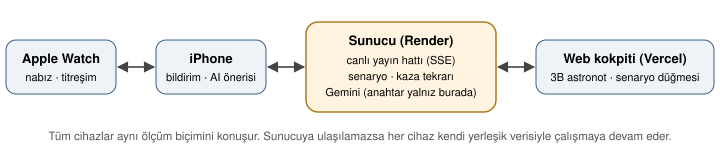

# AntiGravity — Overview & Live Backend (One-Page Pitch)

**Owner:** Osman Melih Gümüş (`@osmnmlh`) · **Area:** Problem → solution story, architecture, live backend, delivery · **Live:** https://antigravity-teal-eight.vercel.app/

## 1. The Problem

- Ay ve Mars görevlerinde astronotu NASA'nın 5 tehlikesi bekler: radyasyon, izolasyon, değişen yerçekimi, Dünya'dan uzaklık, kapalı ve düşmanca ortam.
- Mars'ta Dünya'ya giden tek bir mesaj 20 dakikayı aşabilir. Sağlıktaki değişimi astronot kendisi fark edip karar vermek zorunda.

## 2. Our Solution

- **AntiGravity:** Apple Watch, iPhone ve web kokpitini tek veri diliyle bağlayan, sağlığı yeşil / amber / kırmızı gösteren ve uçuş cerrahına ne zaman başvurulacağını sade dille söyleyen canlı sağlık izleme sistemi.

## 3. How the Data Travels

- **Tek dil:** Saat, telefon ve web aynı ölçüm biçimini kullanır. Yeni bir cihaz eklemek için tercüme gerekmez.
- **Canlı yayın hattı:** Her ekran sunucuya bir kez bağlanır ve açık kalır. Yeni ölçüm gelince sunucu herkese aynı anda haber verir; ekranlar sürekli "yeni bir şey var mı?" diye sormaz.
- **Senaryolar sunucuda:** 11 kriz senaryosu ve 3 tarihî kaza tekrarı (Apollo 13 dahil) sunucuda oynar; değerler 15 saniye boyunca her saniye değişir, herkes aynı anı görür.
- **AI arka planda, güvenli:** Gemini anahtarı yalnızca sunucuda durur. Renkleri eşik motoru belirler, AI sadece açıklar.
- **Kopunca da çalışır:** Sunucu uyursa web ve telefon kendi yerleşik verisiyle devam eder; Gemini cevap vermezse hazır Türkçe öneri gelir.
- **Yayın:** Web Vercel'de, sunucu Render'da (HTTPS, her birleşmede otomatik güncellenir). Yedek plan: tek dizüstü + telefon internet paylaşımı.

## 4. Selling Points for the Jury

- **Güvenli AI:** Yeşil / amber / kırmızı kararını kurallar verir, yapay zekâ yalnızca ne yapılacağını anlatır.
- **Uçtan uca canlı:** Web'den başlatılan bir kriz saniyeler içinde iPhone'da bildirim, bilekte titreşim olur.
- **Dayanıklı:** İnternet, sunucu ya da Gemini olmadan da izleme durmaz.
- **Gerçek krizlerle sınandı:** Apollo 13 gibi tarihî olaylar adım adım yeniden oynatılır.

## 5. Demo Moment (On Stage)

- **Uçtan uca an (~20 sn):** Web'de "Kabin gaz kaçağı" düğmesine basılır; aynı anda web kartı kırmızıya döner, iPhone'a bildirim düşer, saat titrer. 15 saniye sonra her şey kendiliğinden yeşile döner.
- **Sahne arkası:** Demodan önce sunucu uyandırılır ve herkes yeşile sıfırlanır; sorun çıkarsa yedek plana 1 dakikada geçilir.

## 6. Presenter & Timing

- **Osman:** 0:00–1:30 Problem · 1:30–3:00 Çözüm + bu şema · 9:00–10:00 Kapanış (toplam ~4 dk).
- **Canlı demo 3:00–6:00:** Web Ahmet/Ömer · AI Göktuğ · iPhone/Watch Emirhan · veri ve Apollo 13 Mehmet. 6:00–9:00 neden biz ve gelecek.

## 7. Facts & Numbers

- 6 kişi · ~24 saat · 60+ birleşmiş PR · 3 platform · 9 sağlık göstergesi · 3 astronot · 7 mimari karar kaydı.
- Sunucu tek dosya, sıfır ek kütüphane; veritabanı yok, yeniden başlatınca temiz demo verisine döner.

## 8. Next Steps

- HealthKit'ten gerçek veri, internet hiç yokken cihaz üstünde çalışan model, uçuş cerrahı için ayrı panel.

---

*Demo software, not a medical device.*
